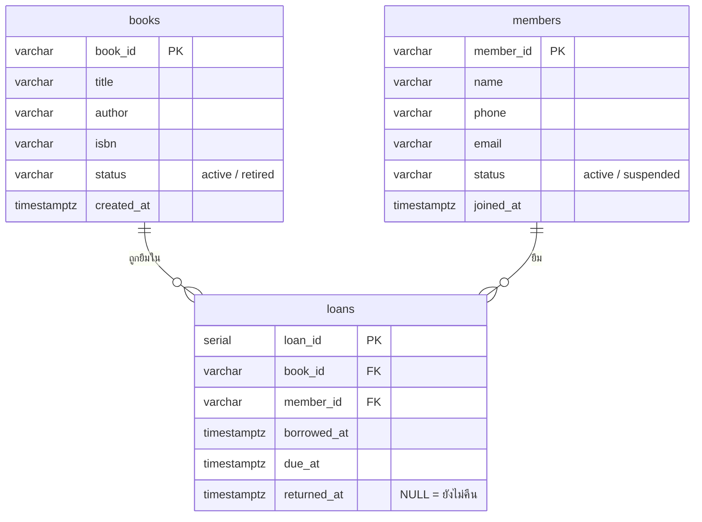

# ระบบห้องสมุดและยืมคืนหนังสือ

เว็บแอปจัดการหนังสือ (รายเล่ม) สมาชิก และการยืมคืน ใช้งานบนมือถือได้

## ลิงก์ระบบ (ออนไลน์)

| หน้า | ลิงก์ |
|---|---|
| 🌐 เปิดระบบ | https://library-system-omega-three.vercel.app |
| 📤 ยืมหนังสือ | https://library-system-omega-three.vercel.app/borrow |
| 📥 คืนหนังสือ | https://library-system-omega-three.vercel.app/return |
| 📚 หนังสือ | https://library-system-omega-three.vercel.app/books |
| 👤 สมาชิก | https://library-system-omega-three.vercel.app/members |
| 🔧 เอกสาร API | https://library-api-4nzv.onrender.com/docs |

> API ใช้ Render แบบฟรี ถ้าไม่มีคนใช้สักพักจะหลับ การเปิดครั้งแรกอาจรอเกือบ 1 นาที

**เงื่อนไขทดสอบ:** หนังสือเล่มเดียวกันมีรายการยืมที่ยังไม่คืนได้ไม่เกิน 1 รายการ
บังคับ 2 ชั้น คือตรวจในโค้ด (`backend/app/services.py`) และ partial unique index ในฐานข้อมูล
(`UNIQUE (book_id) WHERE returned_at IS NULL` ใน `backend/app/models.py`)

## เทคโนโลยี

| ส่วน | ใช้ |
|---|---|
| Front-end | React (Vite) + Tailwind CSS |
| Back-end | FastAPI (Python) + SQLAlchemy |
| ฐานข้อมูล | SQLite (บนเครื่อง) / PostgreSQL บน Neon (ตอน deploy) |
| ทดสอบ | pytest |
| Deploy | Vercel (หน้าเว็บ) + Render (API) + Neon (ฐานข้อมูล) |

## โครงสร้างโปรเจกต์

| โฟลเดอร์ / ไฟล์ | เนื้อหา |
|---|---|
| `backend/` | Source code ฝั่ง API (FastAPI) และเทสต์ (pytest) |
| `frontend/` | Source code หน้าเว็บ (React + Vite + Tailwind) |
| `database/` | **Database Script (PostgreSQL)** |
| `render.yaml` | ตั้งค่า deploy back-end บน Render |
| `DEPLOY.md` | ขั้นตอน deploy |

## Database Script

อยู่ในโฟลเดอร์ [`database/`](database) รันตามลำดับ

| ไฟล์ | หน้าที่ |
|---|---|
| [`schema.sql`](database/schema.sql) | สร้างตาราง `books`, `members`, `loans` พร้อม constraint และ partial unique index ของกฎหลัก |
| [`seed.sql`](database/seed.sql) | ข้อมูลตัวอย่าง (หนังสือ 3 เล่ม, สมาชิก 2 คน, รายการยืม 2 รายการ) |
| [`test_rule.sql`](database/test_rule.sql) | ทดสอบเงื่อนไขของโจทย์ด้วย SQL ล้วน (ทำใน transaction แล้ว ROLLBACK ข้อมูลไม่เปลี่ยน) |
| [`queries.sql`](database/queries.sql) | คำสั่งที่ใช้บ่อย เช่น สถานะหนังสือ รายการค้างคืน เลยกำหนด |

```bash
psql "<connection string>" -f database/schema.sql
psql "<connection string>" -f database/seed.sql
psql "<connection string>" -f database/test_rule.sql
```

หรือคัดลอกเนื้อหาไฟล์ไปวางใน Neon Console → **SQL Editor** แล้วกด Run



## รันบนเครื่อง

**Back-end** (ในโฟลเดอร์ `backend`)

```bash
python -m venv .venv
.\.venv\Scripts\python.exe -m pip install -r requirements.txt
.\.venv\Scripts\fastapi.exe dev app/main.py
```

เอกสาร API: http://127.0.0.1:8000/docs

**Front-end** (ในโฟลเดอร์ `frontend` เปิดอีกหน้าต่าง)

```bash
npm install
npm run dev
```

เปิด http://localhost:5173 (เพิ่ม `-- --host` ต่อท้ายเพื่อเปิดจากมือถือใน Wi-Fi เดียวกัน)

**รันเทสต์** (ในโฟลเดอร์ `backend`)

```bash
.\.venv\Scripts\python.exe -m pytest -v
```

## Deploy

ดูขั้นตอนใน [DEPLOY.md](DEPLOY.md)
